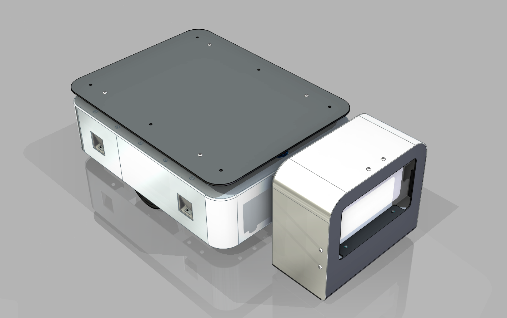

# 环境检测机器人

> 基于升降式移动机器人的室内环境多维感知与建模（毕业设计 · 2026-039）

## 项目简介

本项目以项目组自研的**中型差速 AGV** 为移动平台，在车体上加装**三节升降杆 + 环境检测头**，利用激光 SLAM 定位位姿和升降高度确定传感器的三维坐标，对室内温度、湿度、CO₂ 等环境参数进行"定点 → 测线 → 平面"逐级扩展的测量与建模。

与在空间中大量布置固定传感器相比，"移动平台 + 升降机构"可以用少量传感器覆盖平面和不同高度；前提是正确处理移动测量带来的时空误差。

## 研究内容

| 优先级 | 内容 | 说明 |
|---|---|---|
| 必须完成 | 传感器位姿建模 | SLAM 位姿 (x, y, θ) + 升降高度 h → 正运动学 → 传感器坐标 (X, Y, Z)，统一时间戳 |
| 必须完成 | 定点多高度测量 | 多测点、多高度停留测量，建立垂直分布模型，作为后续实验的参考真值 |
| 主体工作 | 测线测量与滞后补偿 | 边走边测时传感器响应滞后，读数被"拖尾"；以离散卷积建模测量过程，标定时间常数 τ，用反卷积（逐个剥离）补偿 |
| 争取完成 | 平面环境场重建 | IDW / 克里金 / 高斯过程回归插值，交叉验证比较精度 |
| 扩展 | 自适应采样 | 按 GPR 不确定度选择下一个测点 |
| 配套 | 数据接口与可视化 | 统一数据格式（CSV/JSON），C# 上位机展示 |

### 核心方法：卷积与剥离反卷积

- **正向**：沿线真实分布按 s = v·t 变成时间输入，每个环境值乘以传感器冲激响应 h 拖出一条"尾巴"，所有尾巴叠加就是读数（离散卷积）。
- **反向**：从第一个读数开始，减去前面各值在当前时刻留下的旧拖尾，再除以冲激响应头值 h₀，逐个还原真实环境。
- **三维映射**：三维轨迹 p(t) → 弧长 s(t) → 在时间上补偿 → 按 s 放回 (X, Y, Z)。

## 平台参数

| 项目 | 参数 |
|---|---|
| 承载重量 | 50 kg |
| 驱动方式 | 差速驱动 / 步科一体式电机 |
| 导航方式 | 激光 SLAM + 多雷达融合 |
| 电池 | 48 V 锂电池 |
| 充电方式 | 自动充电刷块 + 手动充电口 |
| 环境检测机构 | 三节升降杆 + 检测头（温度 / 湿度 / CO₂ 等） |

## 目录结构

| 目录 | 内容 |
|---|---|
| [b-Module-SE](./b-Module-SE) | Solid Edge 三维模型：`0000-AGV` 总装、`1000-底盘`、`2000-电器`、`3000-外壳`、`4000-环境检测`（`4100-升降`、`4200-检测`）、`0100-屏幕`、`0200-充电桩` |
| [b-Module-GE](./b-Module-GE) | 通用格式模型（STEP） |
| [b-Module-2D](./b-Module-2D) | 二维加工图纸（DWG）及加工购买资料 |
| [b-EPLAN](./b-EPLAN) | 电气原理图（EPLAN 工程及 PDF） |
| [b-Office](./b-Office) | BOM 表、正运动学推导、开题材料、演示视频、学校毕设模板 |
| [b-References](./b-References) | 电机、驱动器、雷达等器件说明书 |
| [b-Picture](./b-Picture) | 效果图、装配图 |
| [b-code](./b-code) | 本地模型实验代码（独立实验，与机器人无直接关系，见其 README） |
| `Note.txt` | 临时想法 |

## 保留内容

### logo与作者

- 作者：pinavia
- 

### 学习许可与权利保留

- 本项目允许个人、学校和研究者进行非商业性的学习、研究和引用。
- 未经著作权人书面许可，不得将项目内容用于商业开发、产品制造、商业服务、商业宣传、投标交付、毕业设计成品交付或再授权。
- 不得删除作者、来源、版本历史和第三方许可证声明，不得将本项目或其衍生成果宣称为与作者无关的原创项目。
- 软件源码适用 [PolyForm Noncommercial 1.0.0](https://polyformproject.org/licenses/noncommercial/1.0.0/)；机械模型、PCB、原理图、图片、文档、Unity 工程和其他非软件资料适用 [CC BY-NC-ND 4.0](https://creativecommons.org/licenses/by-nc-nd/4.0/)。
- SE、SW、STEP/STP 及其他三维模型仅允许个人或学校进行非商业学习、评审和研究；未经著作权人书面许可，不得用于加工、打样、制造、销售、量产、投标、产品交付、商业宣传、改作或再授权。
- 第三方组件、模板、元件库、外购件模型和工具仍受其原始许可证约束；本声明不扩大作者对第三方内容的权利。

商业使用、产品化、公司内部长期使用、转让或排他性授权需另行取得著作权人的书面许可。
